# agentic-architectures

> Every major agentic architecture, side by side, in plain Python: augmented LLM, prompt
> chaining, routing, parallelization, orchestrator-workers, evaluator-optimizer, ReAct,
> plan-and-execute, ReWOO, Reflexion, LATS-lite tree search, supervisor and hierarchical
> teams, swarm handoffs, debate, human-in-the-loop, memory, agentic RAG and autonomous
> loops. One tiny shared runtime, no framework, every step traced, every loop budgeted.
> The hub of a 20-repo series that builds the same patterns in LangGraph, Google ADK,
> CrewAI, LangChain and LangSmith.

[](https://github.com/MartinCastroAlvarez/agentic-architectures/actions/workflows/ci.yml)
[](LICENSE)
[](pyproject.toml)
[](pyproject.toml)
[](pyproject.toml)

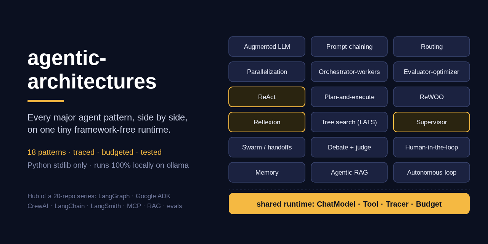

**Runs 100% locally, no paid APIs required.** The default model is an open-weight model
on [ollama](https://ollama.com) (`qwen3:4b`) over plain HTTP to `127.0.0.1`. An
OpenAI-compatible adapter (vLLM, llama.cpp server, LM Studio, or a hosted API with your
own key) is optional. Tests, examples and the benchmark use a scripted fake model and need
no model, no key and no network. The package has **zero runtime dependencies**.

## Why

- **Frameworks hide the architecture.** In LangGraph, ADK or CrewAI the pattern is spread
  across nodes, callbacks and config. Here each pattern is one module of 60-200 lines that
  you can read top to bottom, with the same runtime underneath all of them, so the
  differences you see are the differences between the patterns.
- **The choice of pattern decides the bill.** A ReWOO run costs 2 LLM calls; the same task
  as a hierarchical team costs 6-8. The benchmark measures calls, tokens and the
  *critical path* (the chain of calls that must wait for each other) for every pattern on
  the same tasks, so the trade-offs are numbers, not adjectives.
- **Control flow belongs in code, not in the model.** Every loop has a hard budget, every
  routing or handoff choice is validated, every score is clamped and compared in Python,
  and every piece of tool output is delimited as untrusted data. The tests prove it.
- **A map of the series.** Each pattern links to the sibling repo that implements it in a
  real framework, so you can learn the idea here and the production version there.

## Quickstart

```bash
pip install "agentic-architectures @ git+https://github.com/MartinCastroAlvarez/agentic-architectures"
python -m agentic_architectures list                                  # the 20 runnable patterns
python -m agentic_architectures all --provider fake                   # every pattern, offline, with traces
ollama pull qwen3:4b && python -m agentic_architectures react "What is (120 + 80) / (1.5 + 0.5)?"
python -m agentic_architectures.bench                                 # calls / tokens / latency table
```

Every run prints its trace. A real run with the fake model:

~~~text
$ python -m agentic_architectures plan_execute --provider fake --latency 0.05 "Which TCP port does a local ollama server listen on by default?"
[  0.000s] llm       planner                {"steps": ["Use the search tool to get the fact", "Write the final answer"]}
[  0.050s] plan      planner                Use the search tool to get the fact | Write the final answer
[  0.050s] llm       executor               {"thought": "I need the search tool.", "tool": "search", "args": {"query": "ollama default port"}}
[  0.101s] tool      search                 {"query": "ollama default port"} -> [ollama] # ollama ollama runs open-weight language models on your own machine. The server listens on port 11434 by default …
[  0.102s] llm       executor               {"thought": "I have what I need.", "answer": "ollama listens on port 11434 by default [ollama]."}
[  0.152s] llm       replanner              {"answer": "ollama listens on port 11434 by default [ollama]."}

ollama listens on port 11434 by default [ollama].
[plan_execute] status=answered llm_calls=4 tool_calls=1 tokens=1021 critical_path=4 seconds=0.202
~~~

The replanner saw that the first step already answered the question and finished early,
skipping the second planned step. Each pattern also has its own example:
`python -m examples.<pattern>` (offline by default, `AGENTIC_PROVIDER=ollama` for a real
model).

```python
from agentic_architectures import build_runtime
from agentic_architectures.core.providers import OllamaModel
from agentic_architectures.patterns import rewoo

rt = build_runtime(OllamaModel("qwen3:4b"))
result = rewoo.run(rt, "Which TCP port does a local ollama server listen on by default?")
print(result.answer, result.status, result.stats)   # stats: llm_calls, tool_calls, tokens, critical_path
print(rt.tracer.render())
```

## Which pattern should I use?

Start at the top and stop at the first box that fits. Most tasks stop in the first two
rows: add complexity only when a simpler pattern measurably fails.

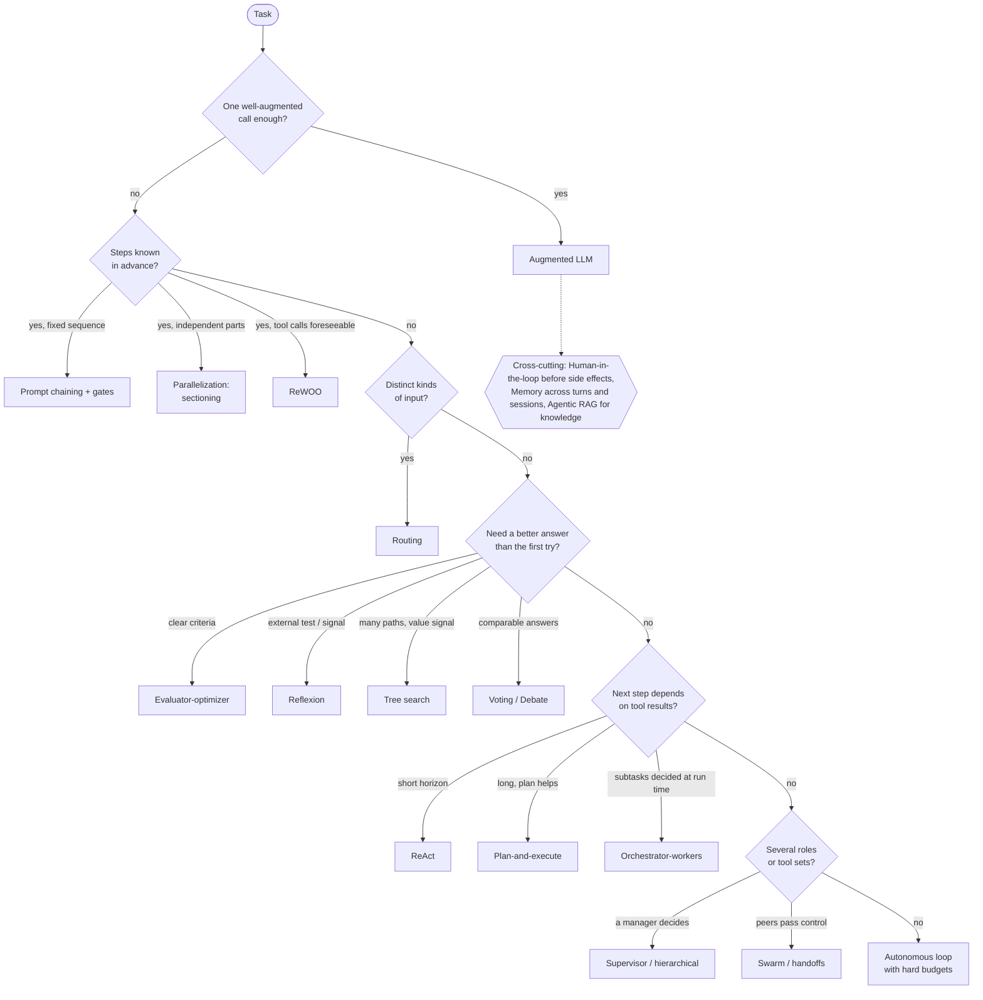

## Comparison

Numbers are means over the three benchmark tasks (one maths, one lookup, one writing
task) with the fake model; *critical path* is the number of LLM calls that had to run one
after another, the floor on latency. Reliability is a qualitative rating from the
literature and the failure modes in each module's docstring.

| Pattern | LLM calls | Critical path | Latency | Reliability | Use when |
|---|---:|---:|---|---|---|
| [Augmented LLM](agentic_architectures/patterns/augmented.py) | 1.7 | 1.7 | lowest | high on easy tasks | most tasks: try this first |
| [Prompt chaining + gates](agentic_architectures/patterns/chaining.py) | 3 | 3 | sum of steps | high (gates catch drift) | fixed decomposition (outline → draft → polish) |
| [Routing](agentic_architectures/patterns/routing.py) | 2.7 | 2.7 | +1 call | depends on the router | distinct input categories, cheap vs strong model |
| [Parallelization: sectioning](agentic_architectures/patterns/parallelization.py) | 4 | 2 | slowest branch + 1 | medium-high | independent aspects, guardrails beside the main call |
| [Parallelization: voting](agentic_architectures/patterns/parallelization.py) | 3 | 1 | one call | higher than one sample | comparable answers (labels, numbers) |
| [Orchestrator-workers](agentic_architectures/patterns/orchestrator_workers.py) | 5.3 | 3.7 | 2 + slowest worker | medium | decomposition depends on the input |
| [Evaluator-optimizer](agentic_architectures/patterns/evaluator_optimizer.py) | 4 | 4 | 2 per round | high with good criteria | clear criteria, iteration helps |
| [ReAct](agentic_architectures/patterns/react.py) | 1.7 | 1.7 | one call per step | medium (drifts on long tasks) | next step depends on the last observation |
| [Plan-and-execute](agentic_architectures/patterns/plan_execute.py) | 3.7 | 3.7 | 2 per step | medium-high (replans) | long tasks, legible plans |
| [ReWOO](agentic_architectures/patterns/rewoo.py) | 2 | 2 | 2 calls + tools | medium (no replanning) | foreseeable tool calls, token savings |
| [Reflexion](agentic_architectures/patterns/reflexion.py) | 3.7 | 3.7 | 2-3 per failed try | high with an external evaluator | tests or checks exist; learn across runs |
| [Tree search (LATS-lite)](agentic_architectures/patterns/tree_search.py) | 7 | 4 | 2 per expansion | highest, if the value signal is good | hard problems, many plausible paths |
| [Supervisor](agentic_architectures/patterns/supervisor.py) | 5 | 5 | +1 call per turn | medium | specialists, order depends on results |
| [Hierarchical teams](agentic_architectures/patterns/supervisor.py) | 6.3 | 6.3 | +1 call per level | medium | many specialists, contain context per team |
| [Swarm / handoffs](agentic_architectures/patterns/swarm.py) | 2.7 | 2.7 | one call per turn | medium (no owner) | triage → specialist flows |
| [Debate + judge](agentic_architectures/patterns/debate.py) | 7 | 3 | rounds + 1 | high on reasoning and facts | answers worth cross-examining |
| [Human-in-the-loop](agentic_architectures/patterns/human_in_the_loop.py) | 2.7 | 2.7 | + human time | highest for side effects | irreversible or regulated actions |
| [Short + long-term memory](agentic_architectures/patterns/memory.py) | 2 | 2 | +1 extraction call | depends on the facts | multi-turn chat, personalisation |
| [Agentic RAG](agentic_architectures/patterns/agentic_rag.py) | 2.3 | 2.3 | +1-2 calls | high (grounded, cited) | knowledge-heavy questions over a corpus |
| [Autonomous loop + budgets](agentic_architectures/patterns/autonomous.py) | 3.7 | 3.7 | unbounded but capped | lowest (compounding errors) | open-ended goals in a sandbox |

## How it works

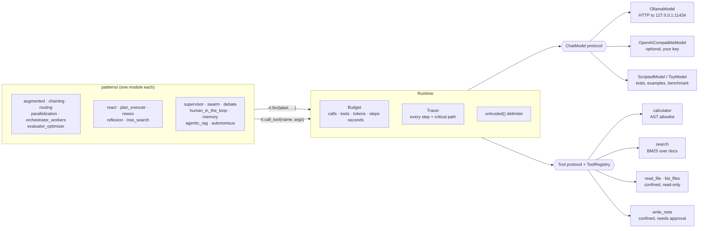

- **`ChatModel`** is one method: `chat(messages, *, label, json_mode) -> Reply`. The
  *label* names the role a call plays (`router`, `planner`, `worker:researcher`...);
  providers ignore it, the fake model answers by it, the tracer prints it.
- **`Runtime.llm`** charges the budget, calls the model, records the step (with tokens
  and timing). **`Runtime.call_tool`** validates arguments through the registry, runs the
  tool, and returns its output wrapped in `<untrusted source="tool:…">`, escaped so it
  cannot close its own block. **`Runtime.parallel`** fans out on a bounded thread pool and
  joins the tracer's critical path.
- **`act`** is the shared "call a tool or answer" step (JSON protocol, bounded, refuses
  a repeated identical call). ReAct, workers, executors and routes build on it.
- **`run_pattern`** turns a `BudgetExceeded` into a result with status `budget:<limit>`
  and the best answer so far: budgets end runs, not processes.

## The patterns

Each module's docstring covers when to use it, trade-offs, cost profile (LLM calls per
task), failure modes and sources. Each has an example in [`examples/`](examples) and
control-flow tests in [`tests/`](tests).

### Workflows (predefined paths)

**Augmented LLM** ([module](agentic_architectures/patterns/augmented.py)): retrieval and
recalled memories go into the prompt; the model may call a tool; the exchange is written
back to memory. *Anthropic, "Building effective agents" (2024).*

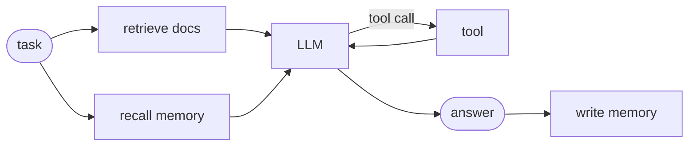

**Prompt chaining + gates** ([module](agentic_architectures/patterns/chaining.py)): fixed
steps, each checked by a Python gate; a failing gate retries once, then stops the chain.

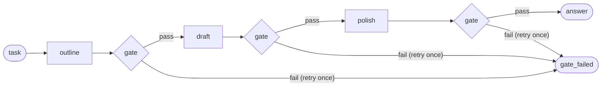

**Routing** ([module](agentic_architectures/patterns/routing.py)): one classification
call, validated in code (unknown → `general`); each route gets only its own tools.

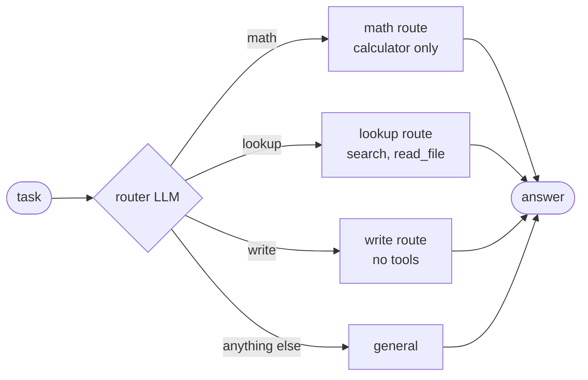

**Parallelization** ([module](agentic_architectures/patterns/parallelization.py)):
*sectioning* runs aspects at once and aggregates; *voting* samples n answers and code
counts the majority.

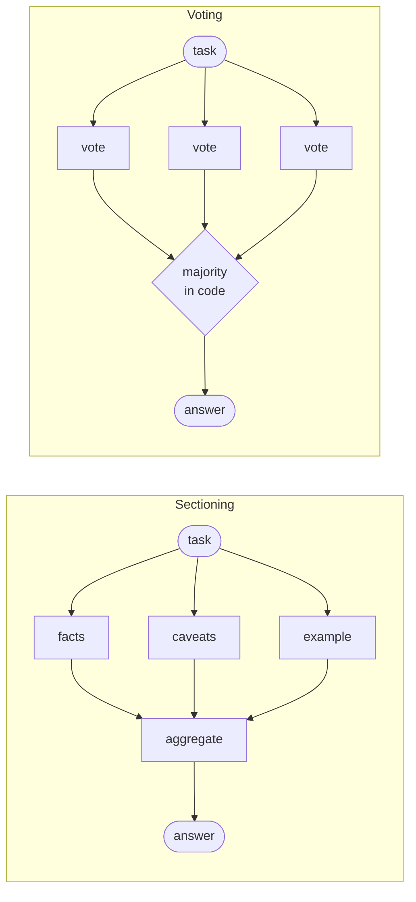

**Orchestrator-workers** ([module](agentic_architectures/patterns/orchestrator_workers.py)):
the orchestrator writes the subtasks at run time (capped, de-duplicated), tool-using
workers run in parallel, a synthesiser merges.

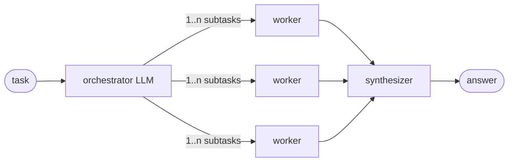

**Evaluator-optimizer** ([module](agentic_architectures/patterns/evaluator_optimizer.py)):
generator and critic loop until the clamped score clears the threshold; the best draft
wins.

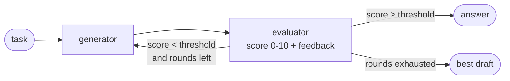

### Single agents (the model drives)

**ReAct** ([module](agentic_architectures/patterns/react.py)): thought → action →
observation until an answer or the step limit. *Yao et al., ICLR 2023.*

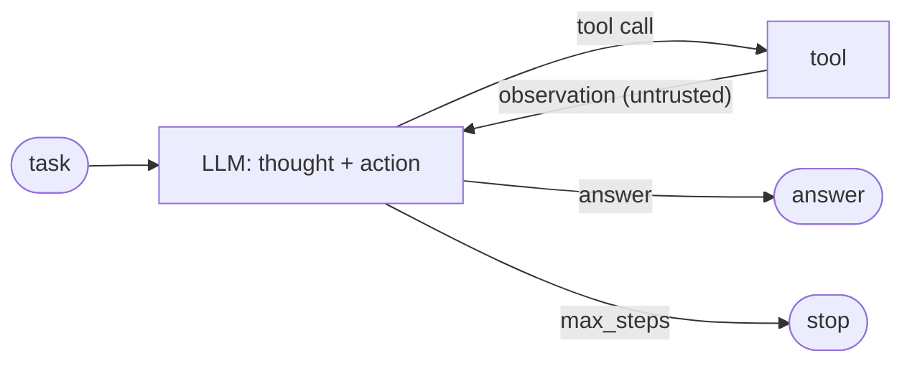

**Plan-and-execute** ([module](agentic_architectures/patterns/plan_execute.py)): planner →
one step at a time by a ReAct executor → replanner finishes or rewrites the remaining
plan. *Wang et al., 2023; LangChain, 2023.*

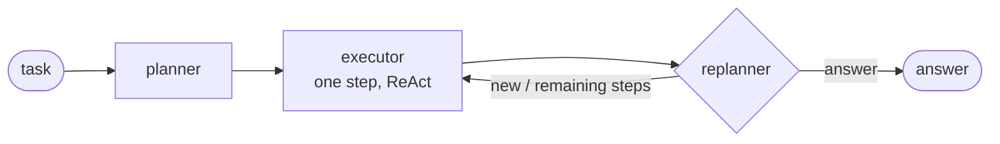

**ReWOO** ([module](agentic_architectures/patterns/rewoo.py)): the whole tool plan with
`#E` placeholders in one call, tools run without the model (independent steps in
parallel, LLMCompiler-style), one solver call. *Xu et al., 2023; Kim et al., ICML 2024.*

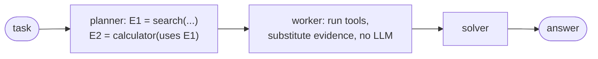

**Reflexion** ([module](agentic_architectures/patterns/reflexion.py)): attempt → external
evaluator → verbal lesson in episodic memory → retry with every lesson. *Shinn et al.,
NeurIPS 2023.*

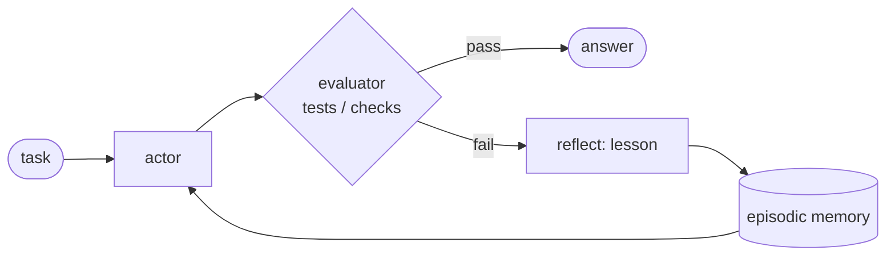

**Tree search (LATS-lite)** ([module](agentic_architectures/patterns/tree_search.py)):
select by UCT, expand candidates, score each with a value call, backpropagate; stop when a
node clears the threshold. *Zhou et al., ICML 2024; Yao et al., NeurIPS 2023.*

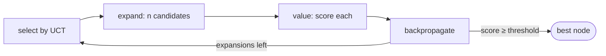

### Multi-agent

**Supervisor / hierarchical teams** ([module](agentic_architectures/patterns/supervisor.py)):
a manager picks the next worker (validated) until `FINISH`; a worker can be a team with
its own supervisor. *AutoGen (Wu et al., 2023); LangGraph supervisor; CrewAI hierarchical.*

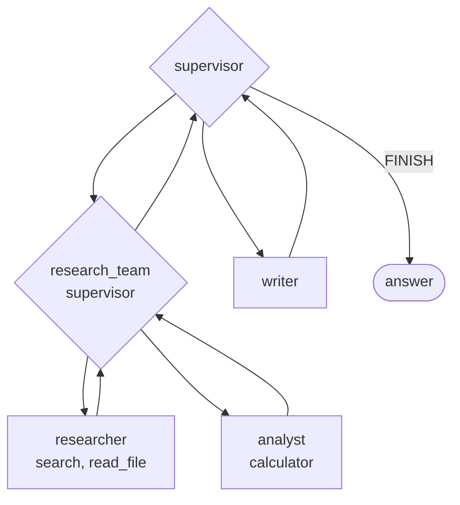

**Swarm / handoffs** ([module](agentic_architectures/patterns/swarm.py)): peers pass the
conversation along an allowed handoff graph; no central manager. *OpenAI Swarm / Agents
SDK, 2024.*

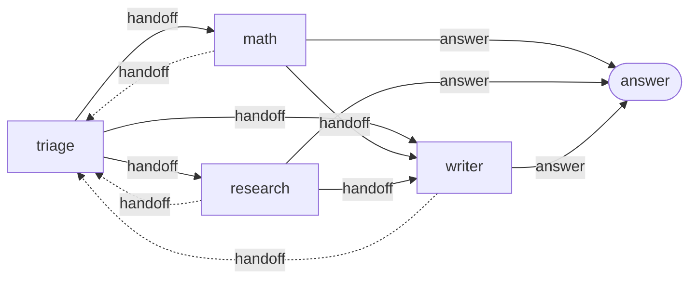

**Debate + judge** ([module](agentic_architectures/patterns/debate.py)): debaters answer,
read each other, revise; consensus ends early; a judge decides (majority fallback).
*Du et al., 2023; Liang et al., 2023.*

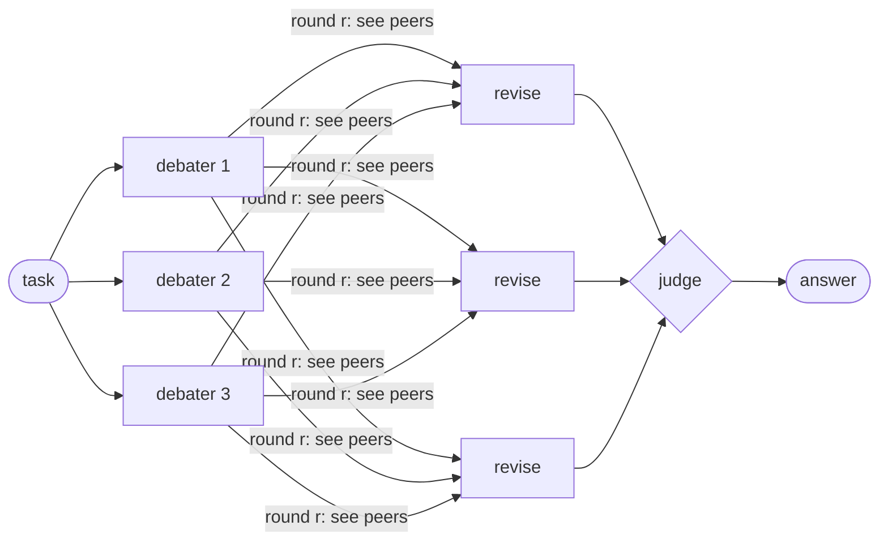

### Cross-cutting

**Human-in-the-loop** ([module](agentic_architectures/patterns/human_in_the_loop.py)): a
call to an approval-gated tool stops the run with a JSON checkpoint; `resume()` applies
approve / edit / reject. *LangGraph `interrupt()`; Anthropic, 2024.*

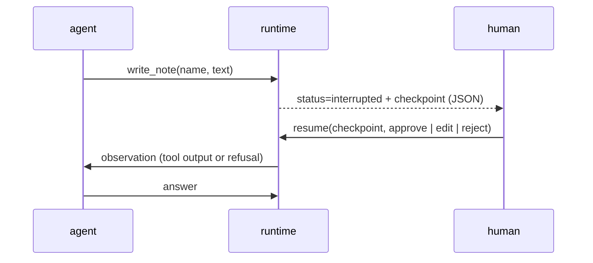

**Short + long-term memory** ([module](agentic_architectures/patterns/memory.py)): a
message window folded into a summary (short-term) and per-user facts extracted, filtered
and recalled across sessions (long-term). *MemGPT, 2023; Generative Agents, 2023.*

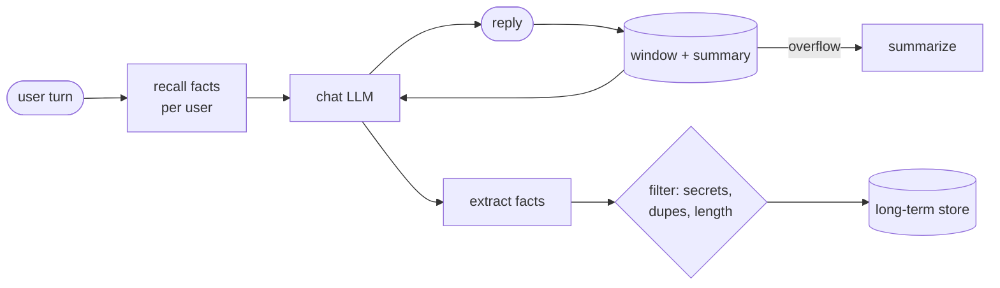

**Agentic RAG** ([module](agentic_architectures/patterns/agentic_rag.py)): decide whether
to retrieve, grade passages, rewrite the query if nothing is relevant, cite only what was
retrieved, or say `no_evidence`. *Self-RAG, CRAG, TAG (Biswal et al., 2024).*

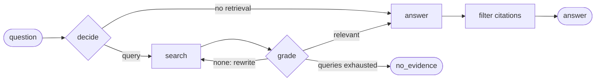

**Autonomous loop + budgets** ([module](agentic_architectures/patterns/autonomous.py)): a
task list, tools, a notebook; ends on the goal, a stall, or a budget. *BabyAGI, AutoGPT
(2023); Anthropic, 2024.*

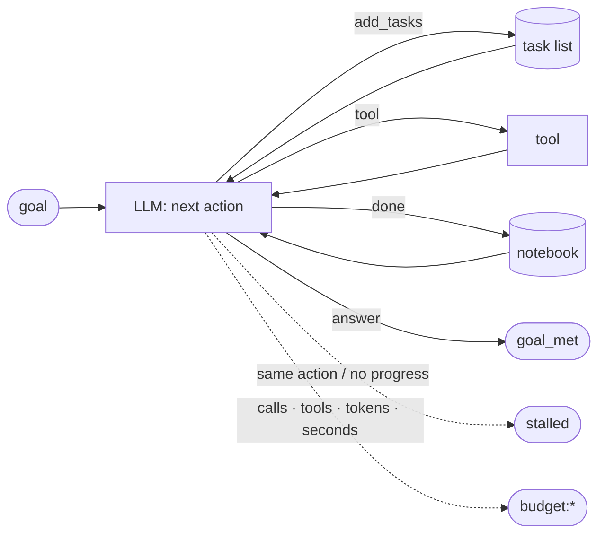

## Benchmark

```bash
python -m agentic_architectures.bench --json docs/benchmark/results.json
```

Every pattern runs the same three tasks (an average-speed calculation that needs the
calculator, a lookup in the bundled documents, a two-sentence explanation) with the toy
fake model, which sleeps 50 ms + 1 ms per output token on every call. Parallel calls
really overlap, sequential calls really add up. Python 3.12.3, 2026-10-25,
[`docs/benchmark/results.json`](docs/benchmark/results.json); a test fails if the
committed counts differ from a fresh run.

| Pattern | LLM calls | Tool calls | Tokens | Critical path | Wall time (s) | Solved |
|---|---:|---:|---:|---:|---:|---:|
| Augmented LLM | 1.67 | 0.67 | 887.67 | 1.67 | 0.14 | 3/3 |
| Prompt chaining + gates | 3 | 0 | 392.33 | 3 | 0.24 | 3/3 |
| Routing | 2.67 | 0.67 | 492.67 | 2.67 | 0.20 | 3/3 |
| Parallelization: sectioning | 4 | 0 | 475 | 2 | 0.15 | 3/3 |
| Parallelization: voting | 3 | 0 | 238.67 | 1 | 0.06 | 3/3 |
| Orchestrator-workers | 5.33 | 1.33 | 1333.33 | 3.67 | 0.32 | 3/3 |
| Evaluator-optimizer | 4 | 0 | 486 | 4 | 0.27 | 3/3 |
| ReAct | 1.67 | 0.67 | 515.67 | 1.67 | 0.14 | 3/3 |
| Plan-and-execute | 3.67 | 0.67 | 902 | 3.67 | 0.29 | 3/3 |
| ReWOO | 2 | 0.67 | 396 | 2 | 0.15 | 3/3 |
| Reflexion | 3.67 | 0.67 | 948 | 3.67 | 0.29 | 3/3 |
| Tree search (LATS-lite) | 7 | 0 | 941.33 | 4 | 0.32 | 3/3 |
| Supervisor | 5 | 0.67 | 1047 | 5 | 0.40 | 3/3 |
| Hierarchical teams | 6.33 | 0.67 | 1275.33 | 6.33 | 0.49 | 3/3 |
| Swarm / handoffs | 2.67 | 0.67 | 667.67 | 2.67 | 0.22 | 3/3 |
| Debate + judge | 7 | 0 | 1071 | 3 | 0.24 | 3/3 |
| Human-in-the-loop | 2.67 | 1.67 | 924.67 | 2.67 | 0.24 | 3/3 |
| Short + long-term memory | 2 | 0 | 202.67 | 2 | 0.13 | 3/3 |
| Agentic RAG | 2.33 | 0 | 338.67 | 2.33 | 0.17 | 3/3 |
| Autonomous loop + budgets | 3.67 | 0.67 | 1146.67 | 3.67 | 0.27 | 3/3 |

How to read it:

- **Calls are not latency.** Debate makes 7 calls but has a critical path of 3, so it
  finishes faster (0.24 s) than the supervisor's 5 sequential calls (0.40 s). Voting's 3
  calls cost one call of wall time.
- **ReWOO vs ReAct.** Both need one tool call here; ReWOO always spends exactly 2 LLM
  calls, ReAct one per step. On multi-tool tasks ReAct's history (and tokens) grows with
  every step, ReWOO's does not.
- **Hierarchy has a price.** The research team adds a supervisor call per decision on
  top of the top-level supervisor: 6.3 calls vs 5 flat.
- **"Solved" is not a quality score.** The toy model is an oracle scripted to be wrong
  first in a few roles (a Reflexion first attempt, one voter, one debater, the first
  tree-search candidates) so the loops do real work. Measure quality with a real model
  and an eval harness ([pytest-llm-evals](https://github.com/MartinCastroAlvarez/pytest-llm-evals),
  [langsmith-agent-evals](https://github.com/MartinCastroAlvarez/langsmith-agent-evals)).

## The series matrix

Every pattern here, and where it is built for real. Framework repos are complete,
tested showcases; tooling repos are libraries you can install.

| Pattern | Framework implementations | Tooling |
|---|---|---|
| Augmented LLM | [langchain-tag-agent](https://github.com/MartinCastroAlvarez/langchain-tag-agent) (tools over SQL) | [repo-graph-mcp](https://github.com/MartinCastroAlvarez/repo-graph-mcp), [serverless-mcp-aws](https://github.com/MartinCastroAlvarez/serverless-mcp-aws), [django-admin-graph](https://github.com/MartinCastroAlvarez/django-admin-graph), [django-admin-skills](https://github.com/MartinCastroAlvarez/django-admin-skills), [django-admin-mcp-api](https://github.com/MartinCastroAlvarez/django-admin-mcp-api) |
| Prompt chaining | [adk-sequential-pipeline](https://github.com/MartinCastroAlvarez/adk-sequential-pipeline) (`SequentialAgent`) | |
| Routing | [crewai-hierarchical-planning](https://github.com/MartinCastroAlvarez/crewai-hierarchical-planning) (Flow router) | [agent-model-router](https://github.com/MartinCastroAlvarez/agent-model-router) (model + effort per request) |
| Parallelization (sectioning, voting) | [langgraph-parallel-agents](https://github.com/MartinCastroAlvarez/langgraph-parallel-agents) | |
| Orchestrator-workers | [langgraph-parallel-agents](https://github.com/MartinCastroAlvarez/langgraph-parallel-agents) (`Send` map-reduce) | |
| Evaluator-optimizer | [adk-sequential-pipeline](https://github.com/MartinCastroAlvarez/adk-sequential-pipeline) (`LoopAgent` writer↔critic), [langgraph-reflection-agent](https://github.com/MartinCastroAlvarez/langgraph-reflection-agent) (rubric critic), [langsmith-agent-evals](https://github.com/MartinCastroAlvarez/langsmith-agent-evals) (LLM-as-judge) | [pytest-llm-evals](https://github.com/MartinCastroAlvarez/pytest-llm-evals) |
| ReAct | [langchain-tag-agent](https://github.com/MartinCastroAlvarez/langchain-tag-agent), [langsmith-agent-evals](https://github.com/MartinCastroAlvarez/langsmith-agent-evals), [langgraph-plan-and-execute](https://github.com/MartinCastroAlvarez/langgraph-plan-and-execute) (executor) | [ui-review-agent](https://github.com/MartinCastroAlvarez/ui-review-agent) (browser ReAct loop) |
| Plan-and-execute | [langgraph-plan-and-execute](https://github.com/MartinCastroAlvarez/langgraph-plan-and-execute), [crewai-hierarchical-planning](https://github.com/MartinCastroAlvarez/crewai-hierarchical-planning) (`planning=True`) | |
| ReWOO / LLMCompiler | [langgraph-plan-and-execute](https://github.com/MartinCastroAlvarez/langgraph-plan-and-execute) | |
| Reflection / Reflexion | [langgraph-reflection-agent](https://github.com/MartinCastroAlvarez/langgraph-reflection-agent) | |
| Tree search (LATS) | [langgraph-reflection-agent](https://github.com/MartinCastroAlvarez/langgraph-reflection-agent) (LATS-lite) | |
| Supervisor / hierarchical | [crewai-hierarchical-planning](https://github.com/MartinCastroAlvarez/crewai-hierarchical-planning) | |
| Swarm / handoffs | here only | |
| Debate + judge | here only | |
| Human-in-the-loop | [crewai-hierarchical-planning](https://github.com/MartinCastroAlvarez/crewai-hierarchical-planning) (`@human_feedback`) | |
| Memory (short + long-term) | [langgraph-short-long-term-memory](https://github.com/MartinCastroAlvarez/langgraph-short-long-term-memory), [adk-vertex-memory-bank](https://github.com/MartinCastroAlvarez/adk-vertex-memory-bank) | [s3-agent-memory](https://github.com/MartinCastroAlvarez/s3-agent-memory) |
| Agentic RAG / TAG | [adk-vertex-vector-search](https://github.com/MartinCastroAlvarez/adk-vertex-vector-search), [langchain-tag-agent](https://github.com/MartinCastroAlvarez/langchain-tag-agent) | [local-rag-ollama](https://github.com/MartinCastroAlvarez/local-rag-ollama) |
| Autonomous loop + budgets | | [ui-review-agent](https://github.com/MartinCastroAlvarez/ui-review-agent) (crawl budget), [agent-lint](https://github.com/MartinCastroAlvarez/agent-lint) (gate for coding agents) |
| Evaluation / observability | [langsmith-agent-evals](https://github.com/MartinCastroAlvarez/langsmith-agent-evals) | [pytest-llm-evals](https://github.com/MartinCastroAlvarez/pytest-llm-evals) |

## Configuration

| Variable | Default | Meaning |
| --- | --- | --- |
| `AGENTIC_PROVIDER` | `ollama` | `ollama`, `openai` (any OpenAI-compatible server) or `fake` |
| `AGENTIC_MODEL` | `qwen3:4b` | model id for the provider (`llama3.2`, `qwen3:8b`, ...) |
| `OLLAMA_HOST` | `http://127.0.0.1:11434` | must be loopback unless `AGENTIC_ALLOW_REMOTE=1` |
| `AGENTIC_ALLOW_REMOTE` | unset | `1` allows a non-loopback ollama |
| `OPENAI_BASE_URL` | `http://127.0.0.1:8000/v1` | OpenAI-compatible endpoint (https unless loopback) |
| `OPENAI_API_KEY` | unset | only for the optional OpenAI-compatible adapter; never logged |
| `AGENTIC_TEMPERATURE` | `0` | sampling temperature |
| `AGENTIC_FAKE_LATENCY` | `0` | seconds per call for the `fake` provider |

CLI flags: `--provider`, `--model`, `--docs DIR` (searchable, read-only), `--workspace DIR`
(the only folder a tool may write), `--max-llm-calls`, `--max-seconds`,
`--approve ask|yes|no` (human-in-the-loop policy), `--latency`, `--quiet`, `--json`.
In code, `Budget(max_llm_calls, max_tool_calls, max_steps, max_tokens, max_seconds)` bounds
any run, and every pattern takes its own limits (`max_steps`, `max_rounds`, `max_trials`,
`max_expansions`, `max_turns`, `max_handoffs`...).

## Security

Model output and tool input are untrusted. The calculator walks the AST against an
allowlist (no `eval`); file tools are confined to one directory (no `..`, absolute paths,
hidden files or symlinks); the one writing tool needs human approval; each role gets only
its tools; tool output, documents and other agents' messages are escaped into
`<untrusted>` blocks; every loop is bounded by its own limit and the run budget; resumed
checkpoints are re-validated; the ollama host must be loopback. A test bans `eval`,
`exec`, `pickle`, `subprocess`, `shell=` and third-party imports in the package. Details
and the threat model: [SECURITY.md](SECURITY.md).

## Testing

```bash
poetry install && poetry run pytest          # 119 tests, 97% coverage, ~3 s, offline
```

The tests drive each pattern with `ScriptedModel` (replies by label, every call recorded)
and check **control flow**, not prose: routing falls back on an invented route and a route
cannot call tools it was not given; sectioning and fan-out really overlap in wall time and
the critical path is 2; the critic's `"pass": true` is ignored and the best draft wins;
ReAct refuses a repeated call and an unknown tool; the replanner finishes early, replans
and is capped; ReWOO uses exactly 2 LLM calls and refuses forward references before
running anything; Reflexion's lessons reach the next attempt and the next run; tree search
expands the best node by UCT and backpropagates; supervisors refuse unknown workers and
teams have their own supervisor; swarms refuse handoffs outside the graph and stop handoff
loops; debates stop on consensus and survive an invalid judge; human-in-the-loop writes
nothing before approval, resumes from a JSON round-trip and refuses tampered checkpoints;
memory filters secrets and keeps users apart; agentic RAG rewrites, reports `no_evidence`
and drops citations it never retrieved; the autonomous loop stops on stalls and budgets.
Every example runs, the CLI runs every pattern offline, and the committed benchmark must
match a fresh run.

## Part of the series

| Repo | Framework | Architecture |
|---|---|---|
| [langgraph-parallel-agents](https://github.com/MartinCastroAlvarez/langgraph-parallel-agents) | LangGraph | Parallelization / map-reduce (fan-out, fan-in) |
| [langgraph-plan-and-execute](https://github.com/MartinCastroAlvarez/langgraph-plan-and-execute) | LangGraph | Planning (plan → execute → replan) |
| [langgraph-reflection-agent](https://github.com/MartinCastroAlvarez/langgraph-reflection-agent) | LangGraph | Reflection (Reflexion: draft → critique → revise) |
| [langgraph-short-long-term-memory](https://github.com/MartinCastroAlvarez/langgraph-short-long-term-memory) | LangGraph | Memory: short-term (checkpointer) vs long-term (store) |
| [adk-sequential-pipeline](https://github.com/MartinCastroAlvarez/adk-sequential-pipeline) | Google ADK | Sequential pipeline + generator↔critic loop |
| [adk-vertex-memory-bank](https://github.com/MartinCastroAlvarez/adk-vertex-memory-bank) | Google ADK | Long-term memory (Vertex AI Memory Bank) |
| [adk-vertex-vector-search](https://github.com/MartinCastroAlvarez/adk-vertex-vector-search) | Google ADK | Agentic RAG (Vertex AI Vector Search) |
| [crewai-hierarchical-planning](https://github.com/MartinCastroAlvarez/crewai-hierarchical-planning) | CrewAI | Hierarchical / supervisor with planning |
| [langchain-tag-agent](https://github.com/MartinCastroAlvarez/langchain-tag-agent) | LangChain | Tool-using ReAct agent with Table-Augmented Generation (TAG) |
| [langsmith-agent-evals](https://github.com/MartinCastroAlvarez/langsmith-agent-evals) | LangSmith + LangGraph | Evaluation / observability, LLM-as-judge critic |
| ✅ **agentic-architectures** | framework-free | Catalog: ReAct, router, sequential, parallel, loop, reflection, critic, planning, supervisor, swarm/handoff, debate, human-in-the-loop, memory |
| [s3-agent-memory](https://github.com/MartinCastroAlvarez/s3-agent-memory) | LangGraph store | Agent memory (long-term, S3) |
| [agent-model-router](https://github.com/MartinCastroAlvarez/agent-model-router) | — | Router |

Agent tooling: [agent-lint](https://github.com/MartinCastroAlvarez/agent-lint) ·
[repo-graph-mcp](https://github.com/MartinCastroAlvarez/repo-graph-mcp) ·
[pytest-llm-evals](https://github.com/MartinCastroAlvarez/pytest-llm-evals) ·
[serverless-mcp-aws](https://github.com/MartinCastroAlvarez/serverless-mcp-aws).
Apps: [local-rag-ollama](https://github.com/MartinCastroAlvarez/local-rag-ollama) ·
[ui-review-agent](https://github.com/MartinCastroAlvarez/ui-review-agent).
Django admin family: [django-admin-graph](https://github.com/MartinCastroAlvarez/django-admin-graph) ·
[django-admin-skills](https://github.com/MartinCastroAlvarez/django-admin-skills) ·
[django-admin-mcp-api](https://github.com/MartinCastroAlvarez/django-admin-mcp-api) ·
[django-admin-rest-api](https://github.com/MartinCastroAlvarez/django-admin-rest-api) ·
[django-admin-react](https://github.com/MartinCastroAlvarez/django-admin-react).

## Contributing

See [`CONTRIBUTING.md`](CONTRIBUTING.md), [`ARCHITECTURE.md`](ARCHITECTURE.md),
[`SECURITY.md`](SECURITY.md) and the agent contract in [`CLAUDE.md`](CLAUDE.md).

## License

[MIT](LICENSE) © 2026 Martín Castro Álvarez
